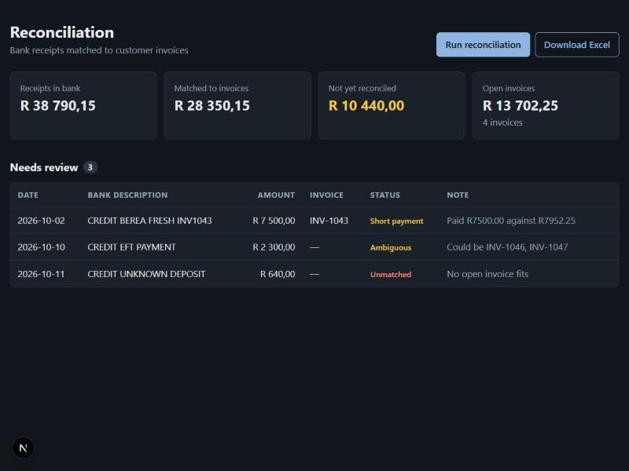
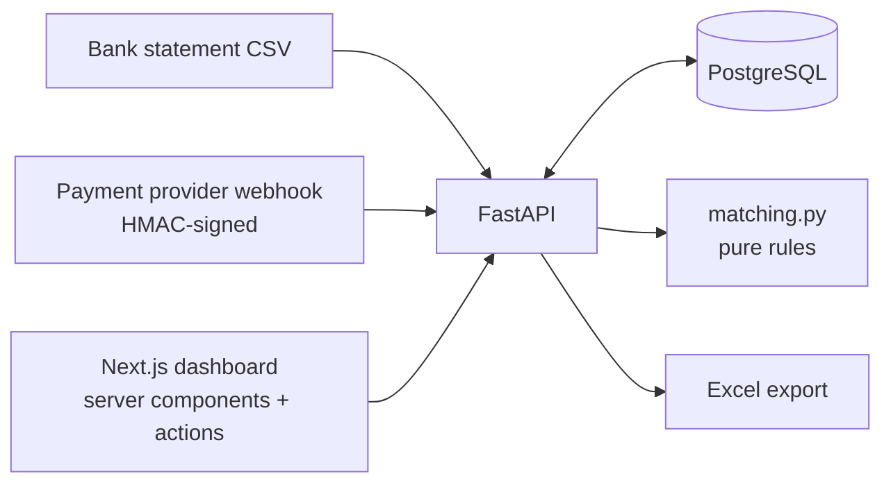

# recon-dashboard

**Bank receipts matched to customer invoices, with a review queue for everything that isn't certain.**

Every morning someone in finance downloads the bank statement and ticks receipts
off against open invoices in Excel. Most lines are easy; a few take most of the
time: payments without a reference, short payments, two invoices for the same
amount. This app does the easy ones automatically and puts the rest in front of
a person with the reason attached.





## How matching works

[`backend/app/matching.py`](backend/app/matching.py) is a pure function with five rules, strongest first:

| Rule | When | Result |
|---|---|---|
| `reference` | Description contains the invoice number (any spacing) and the amount is equal | Matched automatically, invoice marked paid |
| `short_payment` / `over_payment` | Invoice number found but the amount differs | Review queue, with the difference |
| `amount_date` | No reference; exactly one open invoice has the same amount, due within 30 days | Suggested; a person clicks **Confirm** |
| `ambiguous` | Several invoices fit | Review queue, candidates listed |
| `unmatched` | Nothing fits | Review queue |

No AI is involved, on purpose: these rules are exact and auditable. Where AI
*would* earn its place is suggesting a customer for an unmatched deposit from a
messy description; that would go into the review queue as a suggestion, never
as an automatic match.

## What it shows

- **REST API** with FastAPI and SQLAlchemy 2.0, PostgreSQL in production, SQLite for local work.
- **Webhooks done properly**: HMAC-SHA256 over the raw body, constant-time compare,
  timestamp tolerance against replays, idempotency by event id
  ([`security.py`](backend/app/security.py)).
- **Idempotent imports**: re-uploading the same statement changes nothing; one bad row rejects the file with row numbers.
- **Money as `Decimal`** end to end, sent to the browser as strings.
- **Next.js 16** App Router: server components fetch data, server actions run
  reconciliation and confirm matches, a route handler proxies the Excel export.
  The API URL never reaches the browser, so no CORS.
- **Excel export** with a self-checking summary sheet.
- **Tests and CI**: matching rules, API flow and webhook security tested against
  PostgreSQL in GitHub Actions; the frontend is linted and built.
- **Runbook and changelog**: [`docs/RUNBOOK.md`](docs/RUNBOOK.md), [`CHANGELOG.md`](CHANGELOG.md).

## Run it locally

```bash
# API
cd backend
python -m venv .venv && source .venv/bin/activate    # Windows: .venv\Scripts\activate
pip install -e ".[dev]"
python -m pytest -q
python -m app.seed                                   # fictional open invoices
WEBHOOK_SECRET=dev-secret uvicorn app.main:app --reload
curl -F file=@sample_data/bank_statement.csv localhost:8000/imports/bank-statement

# Dashboard (second terminal)
cd frontend
npm install
npm run dev                                          # http://localhost:3000
```

API docs are at http://localhost:8000/docs.

## Deploy

- **Database:** any PostgreSQL, e.g. Supabase. Set `DATABASE_URL=postgresql+psycopg://...`.
- **API:** the [`Dockerfile`](backend/Dockerfile) runs on Render, Fly.io or a VPS. Set `DATABASE_URL` and `WEBHOOK_SECRET`.
- **Dashboard:** Vercel, with root directory `frontend` and `RECON_API_URL` pointing at the API.

The dashboard has no login yet. Before real use it needs authentication (for
example Microsoft Entra ID through Auth.js), and the API should only accept
requests from the dashboard. This is the first item in the changelog's backlog.

## Built with Claude Code

[`CLAUDE.md`](CLAUDE.md) sets the rules (Decimal money, pure matching rules,
nothing auto-matched without an exact reference). The
[`recon-rule-checker`](.claude/agents/recon-rule-checker.md) subagent reviews
any change to the matching rules against a list of finance edge cases before
it's committed.

All invoices and bank lines in this repository are fictional.

## Licence

MIT
